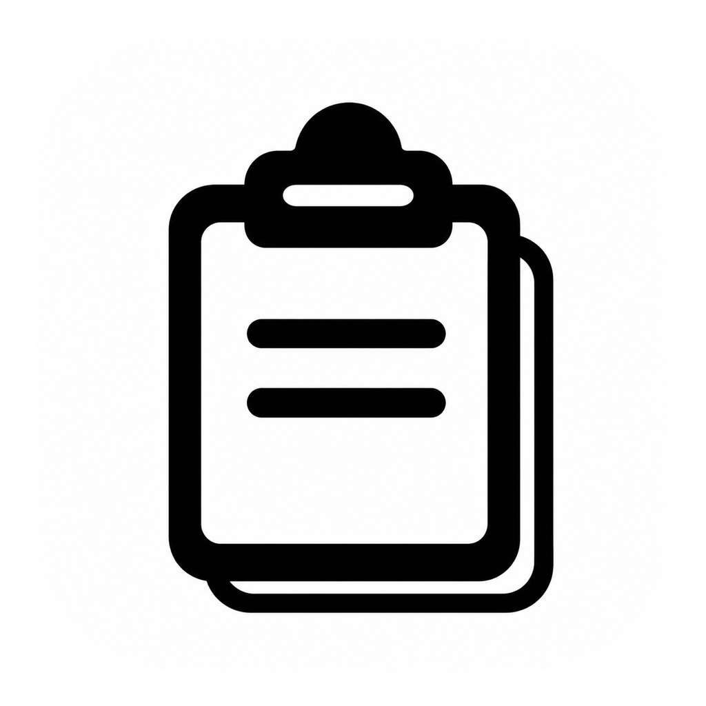

<p align="center">
  
</p>

<h1 align="center">剪藏（ClipNest）</h1>

<p align="center">随手复制，好好收藏。</p>

<p align="center">
  <a href="https://github.com/BrittneyKarbows/ClipNest/releases"></a>
  <a href="#安装与开始使用"></a>
  <a href="#安装与开始使用"></a>
  <a href="#从源码构建"></a>
  <a href="LICENSE"></a>
</p>

<p align="center">
  <a href="https://github.com/BrittneyKarbows/ClipNest/releases">下载应用</a> ·
  <a href="CHANGELOG.md">更新日志</a> ·
  <a href="#从源码构建">构建说明</a> ·
  <a href="mailto:BrittneyKarbows@gmail.com">反馈问题</a>
</p>

---

剪藏会记录你复制过的文字、链接、图片与文件位置。通过全局快捷键呼出底部卡片面板，搜索历史、收藏常用内容，再把需要的记录粘贴回正在使用的应用。

当前版本 **1.2.1**，提供 **Apple Silicon（arm64）** 安装包，要求 **macOS 13 或更新版本**。使用 Swift、SwiftUI、AppKit 和 SQLite 开发，无第三方运行依赖。

1.2.1 启用全新黑白剪贴板图标：夹扣、纸张与叠页清晰表达剪贴板和历史记录；应用、面板、设置和仓库展示统一使用同一图标。

## 功能一览

| 功能 | 说明 |
| --- | --- |
| 剪贴板历史 | 自动记录文字、HTTP/HTTPS 链接、图片和 Finder 文件位置，按内容去重并更新最近复制时间 |
| 卡片面板 | 全局快捷键呼出，横向浏览，支持键盘选择与快速粘贴 |
| 来源识别 | 显示来源应用名称、本机应用图标及复制时间；标题色条从应用图标提取代表色 |
| 搜索与筛选 | 按内容或来源应用搜索，按文字、链接、图片、文件类型筛选 |
| 收藏与分类 | 星标收藏，创建自定义分类；同一条记录可以加入多个分类 |
| 图片预览 | 支持剪贴板图片；单张本地图片文件可后台读取并缓存预览 |
| 直接粘贴 | 授权后可粘贴回原应用，也可仅复制后手动按 ⌘V |
| 自定义快捷键 | 录制呼出组合键、校验组合键并处理注册冲突，可恢复默认 |
| 外观切换 | 跟随系统、浅色、深色三种模式，面板和设置窗口同步更新 |
| 历史管理 | 设置数量上限和保留时间，支持手动清空普通历史 |
| 运行选项 | 登录 Mac 时启动、显示或隐藏菜单栏图标、暂停记录 |
| 应用排除 | 选择不记录的应用，也可输入 Bundle ID |

## 安装与开始使用

1. 从本仓库 **Releases** 下载 `ClipNest-1.2.1-arm64.zip` 并解压。
2. 将 `ClipNest.app` 拖入“应用程序”，然后启动。
3. 在任意应用中复制内容，按默认快捷键 **⌘⇧V** 打开剪藏。
4. 单击卡片选择记录，按**回车**或点击卡片底部的回车箭头粘贴。
5. 需要直接粘贴时，在 **设置 → 快捷键与粘贴 → 直接粘贴权限** 查看授权状态，并按提示为当前应用添加辅助功能权限。

应用默认驻留菜单栏，不显示 Dock 图标。呼出快捷键可自行修改，已有用户的快捷键会继续保留。双击粘贴默认关闭，可在设置中开启。

当前安装包使用本地 ad hoc 签名，尚未经过 Developer ID 签名及 Apple 公证。跨设备分发可能受到 macOS 安全检查限制；也可以下载源码自行构建，无需关闭系统安全保护。

### 常用操作

| 操作 | 快捷键或方式 |
| --- | --- |
| 呼出 / 收起面板 | ⌘⇧V，默认值，可自定义 |
| 从搜索框进入卡片选择 | ↓ |
| 切换卡片 | ← / →，先退出搜索框编辑状态 |
| 粘贴选中记录 | ↩ |
| 仅复制到剪贴板 | ⇧↩ |
| 快速粘贴前九条 | ⌘1–9 |
| 删除选中记录 | ⌘Delete |
| 收起面板 | Esc |
| 打开设置 | ⌘, |
| 退出剪藏 | ⌘Q |

点击星标收藏，右键卡片加入分类或删除。点击分类栏的 **＋** 创建分类；删除分类只移除分类，保留其中的记录。菜单栏图标左键打开面板，右键提供暂停、设置和退出。

## 六个设置分类

| 分类 | 设置内容 |
| --- | --- |
| 通用 | 登录启动、菜单栏图标 |
| 外观 | 跟随系统、浅色、深色 |
| 快捷键与粘贴 | 呼出快捷键、双击粘贴、操作提示、当前构建的直接粘贴授权状态 |
| 历史记录 | 暂停记录、数量上限、自动清理、本地数据位置及手动清空 |
| 隐私 | 排除应用列表、选择应用、按 Bundle ID 添加 |
| 关于与联系 | 软件版本、开发者、邮箱和 GitHub 主页 |

### 历史保留规则

- **数量上限**：100、500、1000 或 2000 条，默认 500 条。收藏和分类中的记录受保护，因此总条数可能超过上限。
- **保留时间**：永不自动删除、7 天、1 个月、3 个月、6 个月或 1 年；默认永不自动删除。
- 自动清理按**最后复制时间**计算，月和年采用日历计算；收藏和分类中的内容不会因过期而删除。
- 应用启动、运行期间每小时、Mac 唤醒或应用重新激活时检查。应用退出期间不清理，下次启动时补做检查。
- 选择周期时，若已有记录将立即过期，界面会显示数量并要求确认。取消会保留原设置。数量上限和保留时间独立生效。

## 图片与文件

剪藏区分直接复制的图片与文件位置。截图工具若同时提供图片和单个文件地址，会优先记录图片；若只提供单张本地图片文件地址，则尝试读取并缓存预览。单条图片上限为 **20 MB**，文字上限为 **1 MB**。

已缓存的图片文件在原文件删除后仍可复制图片。多文件选择保留文件列表；普通文件只记录位置，移动或删除原文件后可能无法继续使用。普通文本里的路径不会被自动读取，远程图片链接不会被下载。

复制图片时提供 PNG 与 TIFF 表示；微信图片直接粘贴使用等待焦点恢复后的按键路径。实际粘贴行为仍取决于目标应用是否接受对应格式。

## 数据与隐私

- 历史保存在 `~/Library/Application Support/ClipNest/`，使用本地 SQLite；应用不上传历史，不含云同步或分析上报。
- 数据库**未加密**。本地目录限制为当前用户访问；备份时请先退出应用，再备份整个目录及 SQLite 关联文件。
- 默认排除常见密码管理器，并跳过剪贴板中的 Concealed、Transient、AutoGenerated 等标记。未带标记的敏感内容无法可靠自动识别，请按需暂停记录或排除应用。
- 排除某个应用只影响后续记录，不会追溯删除已有历史。
- 清空普通历史会保留收藏和分类内容。删除不提供取证级安全擦除，系统备份和磁盘快照也可能保留副本。

更多说明见 [数据与隐私](docs/PRIVACY.md)。

## 从源码构建

在 Mac 上安装 Xcode 或 Xcode Command Line Tools，然后在仓库根目录运行：

```sh
./build.sh
```

默认在仓库的上一级目录生成 `ClipNest.app`。也可以指定输出位置：

```sh
./build.sh ./dist/ClipNest.app
```

构建脚本默认生成 arm64、最低 macOS 13 的应用，使用 ad hoc 签名。也可使用 Xcode 打开 `ClipNest.xcodeproj`，选择 ClipNest scheme 构建。Xcode 工程会按所选目标架构编译，但当前交付与验证范围为 Apple Silicon。

运行检查：

```sh
./test.sh
./test-paste.sh
```

当前版本已通过 **102 项核心检查**与 **26 项直接粘贴状态检查**。测试使用临时数据库、独立命名剪贴板或模拟环境，不读写系统通用剪贴板，也不会向真实应用发送粘贴操作。登录启动、跨应用粘贴和不同 macOS 版本的行为仍需要实机验证。

项目结构、测试范围和签名说明见 [开发文档](docs/DEVELOPMENT.md)。

## 常见问题

**辅助功能已经开启，为什么仍提示未授权？**

系统列表中的同名应用可能对应旧构建或另一位置的副本。请查看设置中的“当前运行位置”，统一使用“应用程序”中的一份剪藏。更新本地签名构建后，可能需要在系统辅助功能中移除旧条目，再添加当前应用。

**授权后只能复制，不能直接粘贴？**

若设置显示按键权限尚未生效，请按 ⌘Q 完全退出，再从“应用程序”重新打开。直接粘贴前，请先在目标应用的输入区域放好光标，再用快捷键呼出剪藏。也可按 ⇧↩ 仅复制，再手动 ⌘V。

**隐藏菜单栏图标后，如何找回剪藏？**

使用已设置的呼出快捷键，或在 Finder 中重新双击应用。快捷键注册失败时，应用会恢复菜单栏图标。

## 当前边界

当前版本保存纯文本，不保留原始富文本、自定义剪贴板格式或网页预览；不含 iCloud 同步、跨设备同步与拖拽粘贴。应用需要处于运行状态才能持续记录剪贴板；极短时间内连续复制的内容可能受到轮询频率影响。

## 版本与反馈

查看 [更新日志](CHANGELOG.md) 和 [1.2.1 发布说明](docs/RELEASE-v1.2.1.md)。

开发者：**BrittneyKarbows**  
邮箱：[BrittneyKarbows@gmail.com](mailto:BrittneyKarbows@gmail.com)  
GitHub：[github.com/BrittneyKarbows](https://github.com/BrittneyKarbows)

反馈时请附上软件版本、macOS 版本、目标应用、复现步骤与面板提示；截图前请隐藏私人剪贴板内容。

本项目采用 [MIT 许可证](LICENSE)。允许使用、修改、分发及商业使用，需保留版权声明和许可证文本。详见 [版权说明](COPYRIGHT.md)。

© 2026 BrittneyKarbows。
